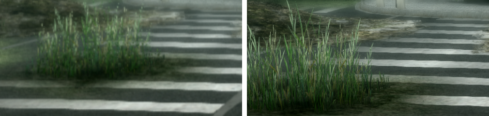
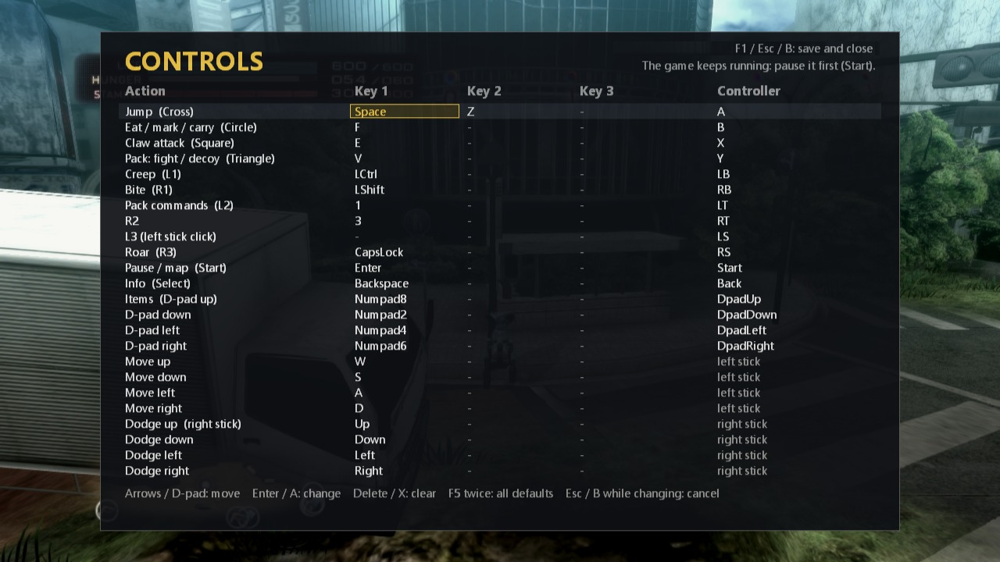
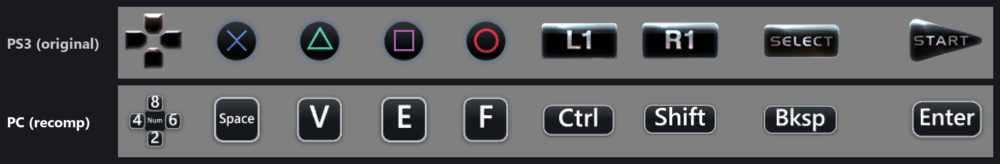

# Tokyo Jungle Recompiled


**A native PC port of Tokyo Jungle (PS3, 2012), made by static recompilation. No emulator.**

Tokyo Jungle was a digital-only PS3 exclusive whose studios are gone, and the PS3 store is closing.
This project turns the game's own PS3 code into a Windows program using
[ps3recomp](https://github.com/sp00nznet/ps3recomp). You supply your own copy of the game.

## Status: Playable

- **Survival mode works start to finish.** A full **102-year run** (about 2 hours) was played with no crash or freeze.
- **60 FPS**, including big fights. In the October 17 play test every second with 800+ draws stayed at 60
  (82 s of play: average 59.9 FPS, one second at 52).
- **2K mode:** renders at 2560x1440 (2x the PS3's 1280x720) for sharp grass and edges. 720p is still the default.
- **PC controls:** keyboard, mouse buttons and Xbox controllers, all rebindable in game. Menus show PC key prompts.
- **Still to check:** Story mode, save and reload across sessions, and local 2-player.




*Left: the PS3's 720p. Right: 2K mode.*

## Controls

Press **F1** in game (or **Back + Start** on a controller) to change any key or button.
Each row shows what the action does. Changes save to `controls.ini` and work right away.



Button prompts in the game's menus show your PC keys instead of PS3 buttons, and follow your bindings:



| Action | Keyboard | Controller |
|--------|----------|------------|
| Move | W A S D | Left stick |
| Dodge | Arrow keys | Right stick |
| Jump | Space or Z | A |
| Eat / mark / carry | F | B |
| Claw attack | E | X |
| Pack: fight / decoy | V | Y |
| Creep / Bite | Left Ctrl / Left Shift | LB / RB |
| Roar | Caps Lock | Right stick click |
| Pack commands | 1 | LT |
| Pause, map / Info | Enter / Backspace | Start / Back |
| Items, menus | Numpad 8 / 2 / 4 / 6 | D-pad |

To quit, close the window. A save in progress finishes first.

## Build and run

You need Windows, CMake, Ninja, LLVM (clang-cl), Visual Studio 2022 Build Tools, Python 3.10+,
and your own legally owned copy of Tokyo Jungle (NPUA80523).

```bash
git clone https://github.com/LasVola/tokyojungle.git
git clone https://github.com/sp00nznet/ps3recomp.git
cd ps3recomp && git checkout d7fff845aca42b5083791801a01d150f5f0ec18c
git apply ../tokyojungle/patches/ps3recomp/ps3recomp-tokyojungle-2026-10-17.patch
cd ../tokyojungle
pip install -r requirements.txt
cp /path/to/your/EBOOT.ELF /path/to/your/PARAM.SFO input/
python scripts/analyze.py && python scripts/gen_stubs.py && python scripts/post_lift.py
python -I scripts/fuse_spu_loops.py --apply   # optional: faster geometry jobs
cmake -B build-clang -G Ninja -DCMAKE_BUILD_TYPE=Release -DCMAKE_C_COMPILER=clang-cl -DCMAKE_CXX_COMPILER=clang-cl
cmake --build build-clang
```

Run it with the tested settings (720p, 60 FPS):

```powershell
powershell -File scripts\launch_tokyojungle.ps1 -Run -Recommended -GameData <your extracted game folder>
```

2K mode (2560x1440, windowed, paced to the monitor's refresh):

```powershell
powershell -File scripts\launch_tokyojungle.ps1 -Run -Recommended -RenderScale 2 -DisplayVBlank -PresentPhase -GameData <your extracted game folder>
```

Which game files this was built and tested with (SHA-256, and the Redump disc it came from):
[docs/GAME_INPUT_HASHES.md](docs/GAME_INPUT_HASHES.md).

## More

- [docs/TESTING.md](docs/TESTING.md): play-test log and frame-pacing numbers
- [docs/HISTORY-2026-09.md](docs/HISTORY-2026-09.md): earlier development notes
- [docs/ABOUT.md](docs/ABOUT.md): how the recompilation works, and why this game

| Region | ID | Format |
|--------|----|--------|
| NA (Digital) | NPUA80523 | PSN (tested) |
| JP (Disc) | BCAS20219 | Blu-ray |
| EU (Digital) | NPEA00421 | PSN |

## Credits and legal

- Original port and ps3recomp: [sp00nznet](https://github.com/sp00nznet).
- This fork: renderer, 60 FPS and 2K work, pacing, stability and controls (August–October 2026), play-tested by LasVola.

The code here is MIT licensed ([LICENSE](LICENSE)). No game data is included; you must use your own copy.
**Tokyo Jungle** is a trademark of Sony Interactive Entertainment. This project is not affiliated with
Sony, Japan Studio or Crispy's.

**Let's keep Tokyo Jungle alive.**
